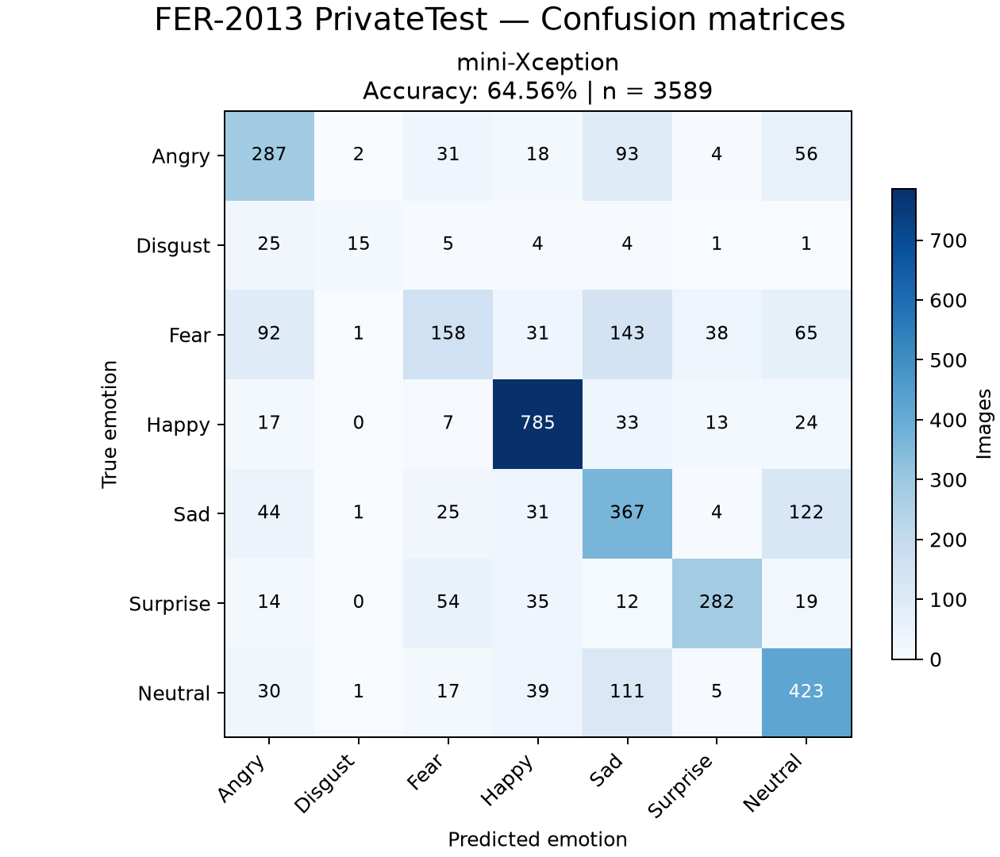
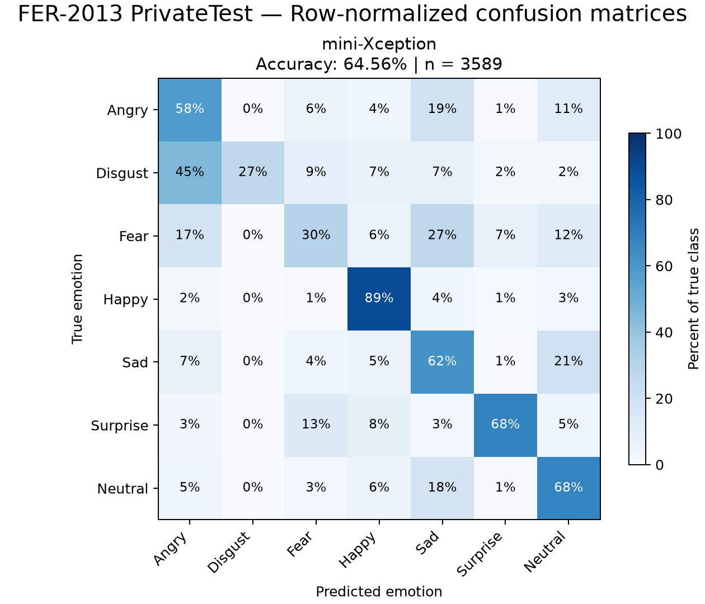

# Confusion matrices

3589 unique PrivateTest images per model. Only repeat 1 is used; timing repetitions do not add independent test images.

Rows are true labels; columns are predicted labels. The diagonal contains correct predictions. Normalized values show the percentage within each true class. N/A indicates a class with no test examples.

CSV files contain exact counts, normalized fractions, and classification reports. This full PrivateTest evaluation gives more stable per-class estimates than the 50-image comparison.
